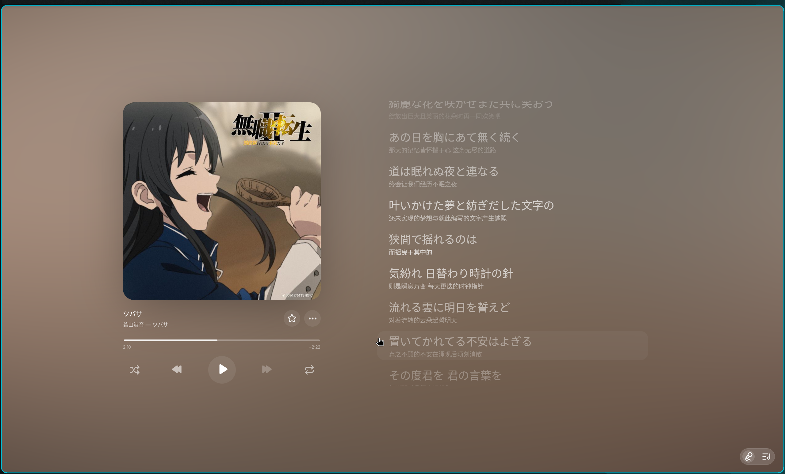
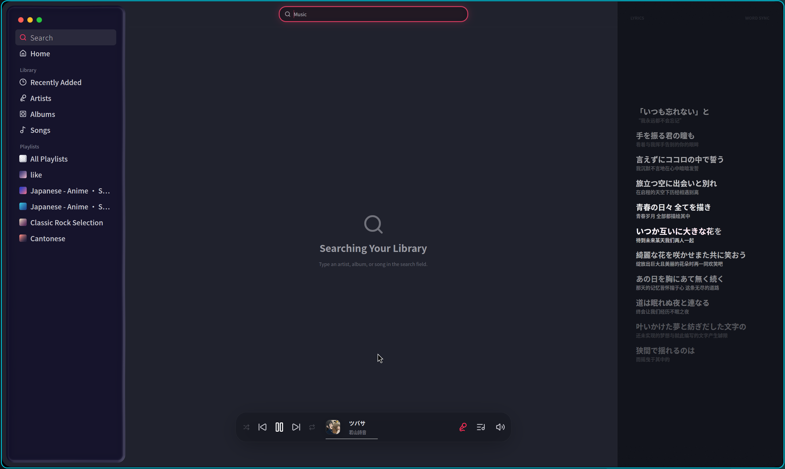

# GPUI Apple Music Demo

一个有点像 Apple Music、既能作为本地音乐播放器使用，也负责展示“哇，GPUI 还能这样？”的 demo。

An Apple Music-ish local player demo whose other job is to make people say, “Wait, GPUI can do that?”





## 中文

这是一个用我 fork 的 [GPUI](https://github.com/cradiy/gpui) 写的 Apple Music 风格 demo。它现在也是一个完整的本地音乐播放器：能管理本地曲库和播放列表，播放音乐，读取元数据、封面与歌词，同时保留了一些挺唬人的动效。

我写它主要是为了展示 GPUI 在桌面 UI、媒体播放和动态视觉效果上的能力，同时验证我在 fork 中增加和改进的功能，可以在一个真实一点、好看一点的场景里一起工作。

### 现在能演示什么

- Apple Music 风格的窗口布局、玻璃侧边栏和播放控制条
- 带封面取色与动态光晕的全屏 Now Playing 界面
- 基于 `gpui_media` 的真实音频播放、进度与控制
- 本地曲库、搜索、收藏、播放队列和播放列表管理
- 内嵌元数据、封面和歌词解析
- 普通逐行 LRC、带结束时间的 LRC，以及逐字歌词 UI
- 歌词高亮、平滑滚动、长音节动效与间奏省略号
- Linux MPRIS 媒体状态，可被桌面面板和媒体键识别
- 面向本地曲库的歌曲、歌手、专辑和播放列表搜索

### 运行

当前支持 Linux、Windows 和 macOS。运行前需要安装可用的 Rust 工具链，以及 GPUI / `gpui_media` 在对应平台所需的系统环境。

```bash
cargo run --release
```

启动后可以直接通过界面选择本地音频或歌词文件。程序记录原始文件路径，并将曲库、播放列表和其他播放器状态保存在本地。

Linux 默认显示右上角的内联窗口按钮。若使用平铺窗口管理器，可在 `~/.config/romus-demo-local-player/config.toml` 中设置以下内容并重启，隐藏窗口按钮（不影响页面工具栏、Windows 或 macOS）：

```toml
[linux]
titlebar = "hidden" # 默认 "inline"
```

### 项目定位

它依旧是一个用于展示 GPUI 桌面 UI、媒体播放和动态视觉效果的 demo，但曲库、搜索、播放队列、收藏和播放列表等核心功能已经按本地播放器完整实现。它不依赖账号或云端服务，歌曲仍保留在原路径，程序只在本地配置中记录曲库和播放列表信息。

## English

This is an Apple Music-inspired demo built with [my GPUI fork](https://github.com/cradiy/gpui). It is also a complete local music player: it manages a local library and playlists, plays audio, reads metadata, artwork, and lyrics, and comes with enough motion and glow to look suspiciously confident.

I built it to showcase what GPUI can do for desktop UI, media playback, and animated visual effects—and to exercise the features and improvements in my fork inside something more convincing than a rectangle named `example`.

### What it demonstrates

- An Apple Music-like window, glass sidebar, and compact player bar
- A fullscreen Now Playing view with artwork-driven animated glow
- Real audio playback, progress, and controls powered by `gpui_media`
- Local library, search, favorites, play queue, and playlist management
- Embedded metadata, artwork, and lyric extraction
- Line-timed LRC, LRC with explicit end times, and word-timed lyric UI
- Lyric highlighting, smooth scrolling, long-syllable motion, and animated gap dots
- Linux MPRIS integration for desktop panels and media keys
- Search across the local song, artist, album, and playlist library

### Run it

The demo supports Linux, Windows, and macOS. You will need a Rust toolchain and the platform-specific system environment required by GPUI and `gpui_media`.

```bash
cargo run --release
```

After startup, use the interface to select local audio or lyric files. The player records the original file paths and keeps the library, playlists, and other player state locally.

On Linux, inline window buttons appear at the top right by default. To hide them, set `[linux]` → `titlebar = "hidden"` in `~/.config/romus-demo-local-player/config.toml` and restart. Use `"inline"` to restore them. This does not affect page tools, Windows, or macOS.

### Project scope

It remains a demo for GPUI desktop UI, media playback, and animated visual effects, but its library, search, queue, favorites, and playlist features are fully implemented as a local player. It has no account or cloud dependency: songs stay at their original paths, while library and playlist information is recorded in local configuration.

## Android

See [Android build and run instructions](apps/android/README.md).

## License and credits

本 demo 采用 [MIT License](LICENSE)，喜欢就拿去玩。要是你顺手又加了什么有意思的功能，记得回来告诉我。

This demo is available under the [MIT License](LICENSE). Fork it, tweak it, make it glow harder—and if you add something interesting, do come back and tell me.
